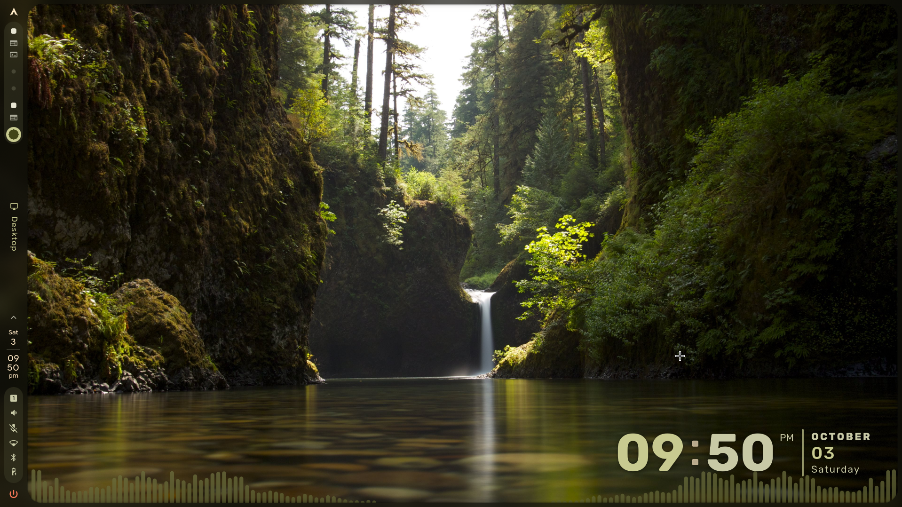
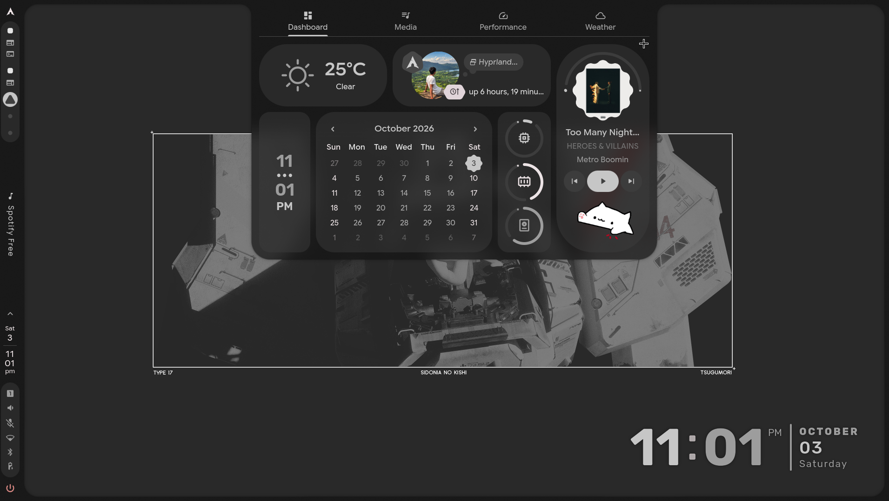
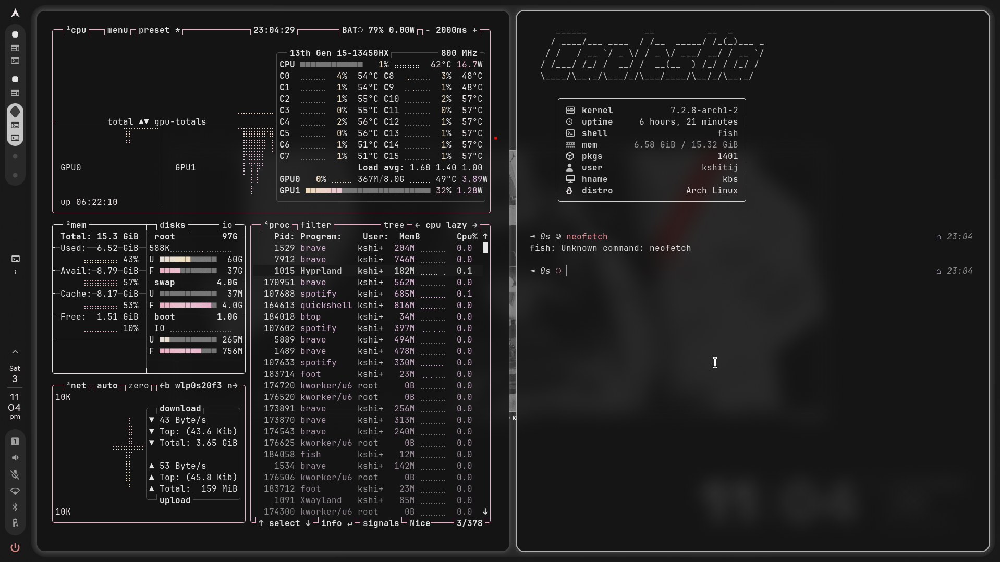
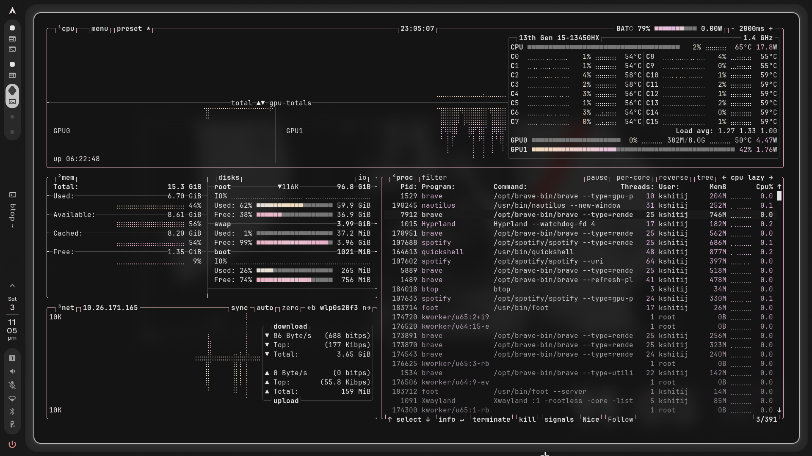
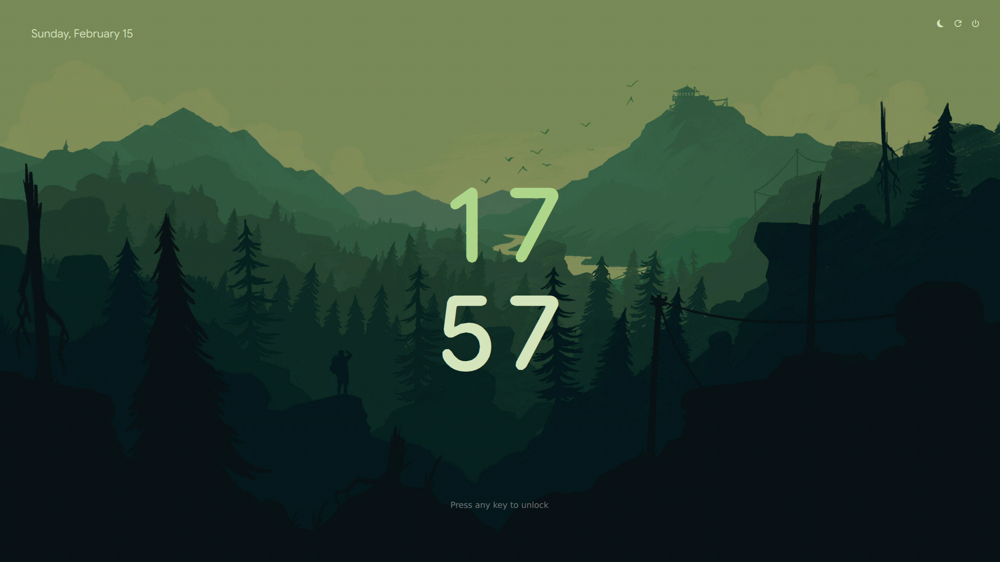
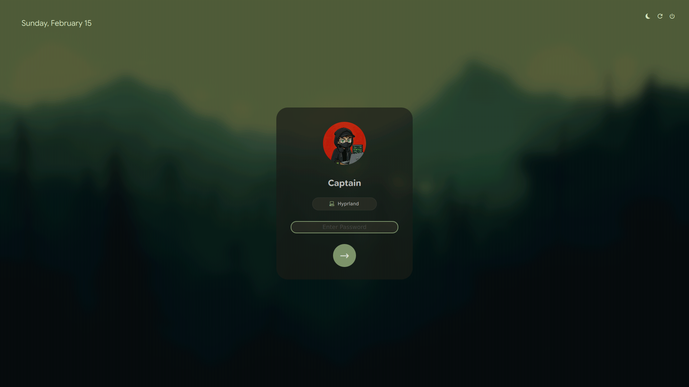
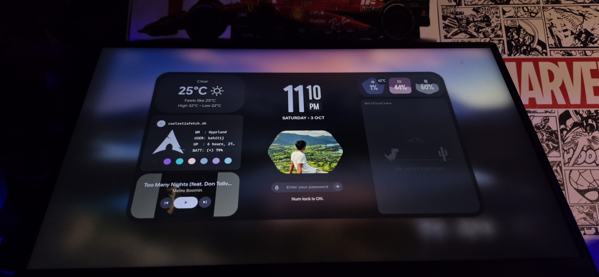

# 🌌 Caelestia + Hyprland Desktop Setup

<div align="center">

[](https://archlinux.org/)
[](https://hyprland.org/)
[](https://github.com/caelestia-dots)
[](https://outfoxxed.me/quickshell/)
[](https://www.gnu.org/software/bash/)
[](LICENSE)

<p align="center">
  <b>A clean, modern, and reproducible desktop overlay for Arch Linux running Hyprland, powered by Caelestia Shell and Quickshell.</b>
  <br />
  Includes an audio-reactive visualizer, minimalist desktop clock, dynamic live weather integration, custom lock screen, and safe non-destructive configuration merging.
</p>

</div>

---

## 🖥️ Desktop Showcase

<div align="center">
  
  <p><i>Clean desktop with waterfall wallpaper, Caelestia vertical dock, real-time bottom CAVA audio visualizer, and bottom-right digital clock.</i></p>
</div>

---

## ✨ Features

- **🕒 Minimalist Desktop Clock & Date**: Large, legible typography positioned at the bottom-right corner with soft ambient drop-shadows.
- **🎵 Audio-Reactive Visualizer**: Smooth, rounded CAVA spectrum visualizer along the bottom edge with automatic silence hiding and subtle blur.
- **⛅ Live Weather Integration**: Dynamic weather forecast widget integrated directly into the Caelestia interactive dashboard.
- **🖼️ Wallpaper & Aesthetic Management**: Harmonious color accents and dynamic wallpaper support.
- **🛡️ Safe Non-Destructive Configuration Merging**: Python-based patcher seamlessly overlays settings into your `shell.json` without wiping out your custom keybinds, modules, or preferences.
- **🔒 Integrated Lock & Greeter Design**: Clean, modern authentication screens featuring blurred backgrounds, avatar badges, and system status indicators.

---

## 📸 Visual Tour

### 🎛️ Interactive Dashboard & Quick Controls
The central Caelestia dashboard provides instantaneous access to real-time weather forecasts, system load gauges (CPU, RAM, Disk), interactive monthly calendar, and media playback with the animated Bongo Cat companion.

<div align="center">
  
</div>

<br />

### 💻 Terminal Workflow & System Specs
Clean, distraction-free tiling layout featuring `fish` shell, `fastfetch` system telemetry on Arch Linux, and `btop` with a custom warm rose/crimson color palette.

<div align="center">
  
</div>

<br />

### 📊 Full-Width System Telemetry (`btop`)
Detailed real-time monitoring of CPU per-core frequencies and temperatures, GPU utilization, disk I/O, process tree, and network throughput.

<div align="center">
  
</div>

<br />

### 🔒 Lock Screen & Display Manager
Consistent aesthetic across authentication layers — from the minimal forest lock screen with centered clock to the frosted-glass user login greeter card.

| Minimalist Lock Screen | Greeter / Login Card |
| :---: | :---: |
|  |  |

<br />

### ⚡ Battlestation in Action
Real-world physical desk setup running the lock screen / greeting dashboard live on an external ultrawide display.

<div align="center">
  
</div>

---

## 🛠️ Tested Environment

This configuration has been tested and verified on:

| Component | Specification / Version |
| :--- | :--- |
| **Operating System** | [Arch Linux](https://archlinux.org/) (Kernel `7.2.8-arch1-2`+) |
| **Compositor / WM** | [Hyprland](https://hyprland.org/) (`0.56.x`+) |
| **Shell Framework** | [Caelestia Shell](https://github.com/caelestia-dots) (`2.5.x`+) |
| **Engine** | [Quickshell](https://outfoxxed.me/quickshell/) (`0.3.x`+) |
| **User Shell** | [Fish Shell](https://fishshell.com/) |
| **Terminal** | [Foot](https://codeberg.org/dnkl/foot) / [Alacritty](https://alacritty.org/) / [Kitty](https://sw.kovidgoyal.net/kitty/) |
| **Audio Visualizer** | [CAVA](https://github.com/karlstav/cava) via PipeWire |
| **Resource Monitor** | [btop](https://github.com/aristocratos/btop) |

---

## 📂 Project Structure

```text
caelestia-hyprland-setup/
├── assets/                         # Screenshots and visual media
│   ├── btop_monitor.png            # Full-width btop resource monitoring
│   ├── dashboard.png               # Interactive Caelestia widgets dashboard
│   ├── desktop.png                 # Main desktop overview with clock & visualizer
│   ├── lock_screen.png             # Ambient lock screen
│   ├── login_screen.png            # Frosted glass login greeter
│   ├── setup_hardware.jpg          # Hardware battlestation photo
│   └── terminal_workspace.png      # Fastfetch & btop tiling workflow
├── config/
│   ├── background.json             # Desktop clock & CAVA visualizer settings
│   └── services.template.json      # Services configuration schema
├── scripts/
│   └── apply.sh                    # Automated non-destructive JSON patch script
├── .gitignore                      # Git ignore rules for dotfile hygiene
└── README.md                       # Documentation
```

---

## 🚀 Quickstart & Installation

> [!NOTE]
> This repository is a lightweight **overlay layer**, not a full fork or replacement of Caelestia. Install [Caelestia Shell](https://github.com/caelestia-dots) and [Quickshell](https://outfoxxed.me/quickshell/) first before applying this configuration.

### 1. Clone the Repository

```bash
git clone https://github.com/kshitij-shingare/kshitij-caelestia-dots.git
cd kshitij-caelestia-dots
```

### 2. Back Up Existing Caelestia Configuration

Before applying changes, make a manual copy of your existing Caelestia settings (the script also creates an automatic timestamped backup):

```bash
cp ~/.config/caelestia/shell.json ~/.config/caelestia/shell.json.backup
```

### 3. Apply the Overlay

Run `scripts/apply.sh` with your desired weather coordinates or city name passed through the `WEATHER_LOCATION` environment variable:

```bash
# Option A: By Coordinates (Latitude, Longitude)
WEATHER_LOCATION="19.0948,74.7480" ./scripts/apply.sh

# Option B: By City and Country
WEATHER_LOCATION="Tokyo,Japan" ./scripts/apply.sh
```

### 4. Restart Caelestia Shell

Reload the daemon to activate the new background overlay and weather services:

```bash
caelestia shell -k
caelestia shell -d
```

---

## ⚙️ Configuration Details

### Desktop Clock & Audio Visualizer (`config/background.json`)

The background configuration manages the position, scaling, drop shadows, and audio spectrum behavior:

```json
{
  "wallpaperEnabled": true,
  "enabled": true,
  "desktopClock": {
    "enabled": true,
    "scale": 1.0,
    "position": "bottom-right",
    "invertColors": false,
    "background": {
      "enabled": false,
      "opacity": 0.7,
      "blur": true
    },
    "shadow": {
      "enabled": true,
      "opacity": 0.7,
      "blur": 0.4
    }
  },
  "visualiser": {
    "enabled": true,
    "autoHide": true,
    "blur": true,
    "rounding": 1,
    "spacing": 1
  }
}
```

- **`desktopClock.position`**: Corner alignment (`"bottom-right"`, `"bottom-left"`, `"top-right"`, `"top-left"`).
- **`desktopClock.scale`**: Font multiplier for time and date presentation.
- **`visualiser.autoHide`**: Automatically hides visualizer bars when no audio stream is active.
- **`visualiser.rounding` & `spacing`**: Controls bar border radius and pixel spacing between spectrum frequencies.

### How the Safe Merger Works (`scripts/apply.sh`)

Instead of replacing `~/.config/caelestia/shell.json` and breaking your personal customizations, `apply.sh`:
1. Verifies that `~/.config/caelestia/shell.json` exists.
2. Creates an immutable timestamped backup (e.g., `shell.json.backup-20261003-231500`).
3. Uses an embedded Python routine to parse your current JSON.
4. Deep-merges the `background` object and updates `services.weatherLocation`.
5. Preserves all other top-level keys (`bar`, `dock`, `keybinds`, `theme`, etc.).
6. Pretty-prints and formats the resulting JSON file safely.

---

## 🔒 Privacy & Public Dotfiles

> [!IMPORTANT]
> The weather location is intentionally supplied via the `WEATHER_LOCATION` environment variable at apply time. This prevents your exact private geographic coordinates or home city from being tracked or exposed in public Git dotfile repositories.

Never commit personal secrets, private API tokens, or machine-specific hardware paths to version control.

---

## ❓ Troubleshooting

<details>
<summary><b>1. The audio visualizer is flat or not moving</b></summary>

- Ensure `cava` and `pipewire-pulse` are installed and running.
- Verify your default audio sink is playing audio:
  ```bash
  wpctl status
  ```
- Make sure `"enabled": true` is set in `background.json`.
</details>

<details>
<summary><b>2. Weather is showing incorrect or no data</b></summary>

- Re-run the apply script with explicit decimal coordinates:
  ```bash
  WEATHER_LOCATION="<LATITUDE>,<LONGITUDE>" ./scripts/apply.sh
  ```
- Check that your network connection has access to the Caelestia weather provider.
</details>

<details>
<summary><b>3. How do I restore my original configuration?</b></summary>

Simply copy back your timestamped backup:
```bash
cp ~/.config/caelestia/shell.json.backup-* ~/.config/caelestia/shell.json
caelestia shell -k && caelestia shell -d
```
</details>

---

## 🤝 Acknowledgements

- [Hyprland](https://github.com/hyprwm/Hyprland) — Dynamic tiling Wayland compositor.
- [Caelestia Shell](https://github.com/caelestia-dots) — Modern, extensible Wayland desktop shell.
- [Quickshell](https://outfoxxed.me/quickshell/) — Reactive desktop widget framework built on Qt & QML.
- [CAVA](https://github.com/karlstav/cava) — Console-based Audio Visualizer for ALSA and PipeWire.
